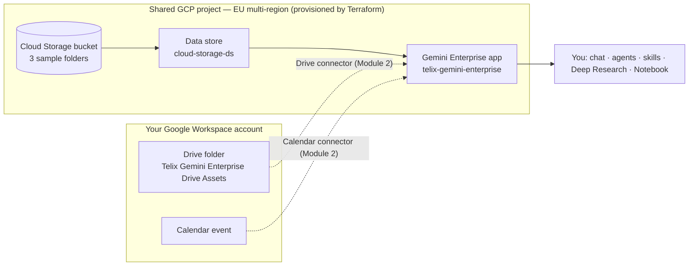

# Introduction to Gemini Enterprise — Telix Hands-on Workshop

A guided, hands-on tour of **Google Gemini Enterprise** for **Telix Pharmaceuticals**,
built around a fictional **Clinical Operations & Medical Affairs** scenario. In about
90 minutes you will search across trial-site, medical-information and investigator-feedback
data, build a custom **Medical Affairs Assistant** agent and a reusable
**medical-writing skill**, run a Deep Research report, and analyse documents in
Gemini Notebook.

> [!IMPORTANT]
> **Participants: all infrastructure is already provisioned for you.** You only need a
> browser. Start at [docs/00-getting-started.md](docs/00-getting-started.md).
>
> **Facilitators:** read [FACILITATOR.md](FACILITATOR.md) to set the environment up
> with Terraform the day before the workshop.

> [!NOTE]
> All sample data is **synthetic** (see [data/README.md](data/README.md)). Study codes,
> sites, investigators, enquiries and figures are fictional and do not describe any real
> Telix programme, product, patient or trial result.

## What you will do

| # | Module | Time | You will… |
|---|--------|------|-----------|
| 0 | [Getting started](docs/00-getting-started.md) | 5 min | Open the Telix Gemini Enterprise app and check your access |
| 1 | [Explore your data](docs/01-explore-your-data.md) | 10 min | Look at the sample data in Cloud Storage & Drive, add a Calendar event (one click) |
| 2 | [Connect Google Workspace](docs/02-connect-workspace.md) | 10 min | Connect Google Drive and Google Calendar data stores to the app |
| 3 | [Agents & skills](docs/03-agents-and-skills.md) | 30 min | Chat across your data, build a **Medical Affairs Assistant** agent in Agent Designer, create a **medical-writing style skill** |
| 4 | [Deep Research](docs/04-deep-research.md) | 10 min (async) | Generate a multi-page research report on clinical-trial recruitment trends, with audio overview |
| 5 | [Gemini Notebook](docs/05-gemini-notebook.md) | 20 min | Grounded Q&A over curated sources, Audio Overview, Infographic, Slide Deck |
| 6 | [Explore further](docs/06-explore-further.md) | open | Projects, Canvas, exports, sharing, pre-built agents |

Stuck? See [docs/troubleshooting.md](docs/troubleshooting.md).

## The scenario

You work in Telix's Clinical Operations / Medical Affairs team. Three fictional studies are
recruiting:

| Study | Indication | Phase |
|-------|------------|-------|
| `TLX-PRO-01` | PSMA-targeted PET imaging in biochemically recurrent prostate cancer | 3 |
| `TLX-REN-02` | Carbonic anhydrase IX PET imaging of indeterminate renal masses | 2 |
| `TLX-GLI-03` | Targeted radioligand therapy in recurrent high-grade glioma | 1/2 |

Your data: a **site enrolment tracker**, the **Q1 2026 medical-information enquiry log**
and **investigator feedback**. You will use Gemini Enterprise to spot enrolment risks,
enquiry trends and site concerns, and to draft scientifically-toned communications.

## Architecture



## Prerequisites (participants)

- A Telix Google Workspace account with a **Gemini Enterprise licence**
  (your admin has assigned it).
- The app and all data live in the **EU multi-region** (`eu`); see FACILITATOR.md.
- Membership of the workshop access group (your admin/facilitator added you).
- Chrome, signed in with that account (no Incognito needed).

## Repository layout

```
docs/            Step-by-step participant modules (start here)
FACILITATOR.md   Run-of-show, prerequisites, provisioning, teardown
terraform/       Provisions bucket, sample data, data store, app, IAM (facilitator)
scripts/         preflight.sh (access check), import helper, calendar link generator,
                 generate-sample-data.py (regenerates data/)
data/            Synthetic Telix sample files (CSV / TXT / PNG) + data/README.md
assets/          Screenshots referenced by the docs
```

Based on the Google Cloud Skills Boost lab *GSP1320 – Introduction to Gemini Enterprise*,
adapted for Telix so participants spend their time on product features rather than setup.

## Licence

Apache 2.0 — see [LICENSE](LICENSE).
