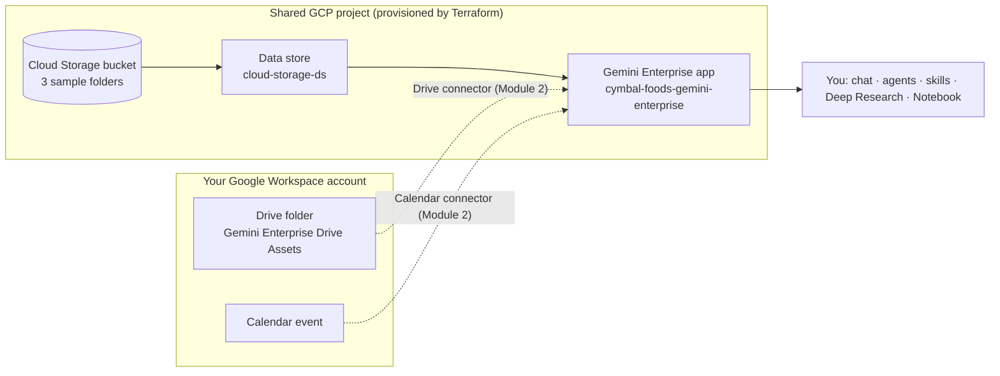

# Introduction to Gemini Enterprise — Hands-on Workshop

A guided, hands-on tour of **Google Gemini Enterprise** using a fictional company,
**Cymbal Foods**. In about 90 minutes you will search across enterprise data, build a
custom agent and a reusable skill, run a Deep Research report, and analyse documents
in Gemini Notebook.

> [!IMPORTANT]
> **Participants: all infrastructure is already provisioned for you.** You only need a
> browser. Start at [docs/00-getting-started.md](docs/00-getting-started.md).
>
> **Facilitators:** read [FACILITATOR.md](FACILITATOR.md) to set the environment up
> with Terraform the day before the workshop.

## What you will do

| # | Module | Time | You will… |
|---|--------|------|-----------|
| 0 | [Getting started](docs/00-getting-started.md) | 5 min | Open the Cymbal Foods Gemini Enterprise app and check your access |
| 1 | [Explore your data](docs/01-explore-your-data.md) | 10 min | Look at the sample data in Cloud Storage & Drive, add a Calendar event (one click) |
| 2 | [Connect Google Workspace](docs/02-connect-workspace.md) | 10 min | Connect Google Drive and Google Calendar data stores to the app |
| 3 | [Agents & skills](docs/03-agents-and-skills.md) | 30 min | Chat across your data, build a **Sales Assistant** agent in Agent Designer, create a **brand-voice skill** |
| 4 | [Deep Research](docs/04-deep-research.md) | 10 min (async) | Generate a multi-page research report with audio overview |
| 5 | [Gemini Notebook](docs/05-gemini-notebook.md) | 20 min | Grounded Q&A over curated sources, Audio Overview, Infographic, Slide Deck |
| 6 | [Explore further](docs/06-explore-further.md) | open | Projects, Canvas, exports, sharing, pre-built agents |

Stuck? See [docs/troubleshooting.md](docs/troubleshooting.md).

## Architecture



## Prerequisites (participants)

- A Google Workspace account in your company domain with a **Gemini Enterprise licence**
  (your admin has assigned it).
- Membership of the workshop access group (your admin/facilitator added you).
- Chrome, signed in with that account (no Incognito needed).

## Repository layout

```
docs/            Step-by-step participant modules (start here)
FACILITATOR.md   Run-of-show, prerequisites, provisioning, teardown
terraform/       Provisions bucket, sample data, data store, app, IAM (facilitator)
scripts/         preflight.sh (one-time access check), import helper, calendar link generator
data/            Cymbal Foods sample files (CSV / TXT / PNG)
assets/          Screenshots used in the docs
```

Based on the Google Cloud Skills Boost lab *GSP1320 – Introduction to Gemini Enterprise*,
adapted so participants spend their time on product features rather than setup.

## Licence

Apache 2.0 — see [LICENSE](LICENSE).

## Access notice

This is a Google-owned Customer Code Sharing Repository (go/gtm-github). External access is
read-only and **temporary (30 days)** — clone the content before the expiry date listed in
[METADATA.json](METADATA.json).
